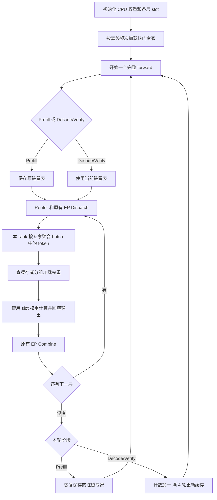
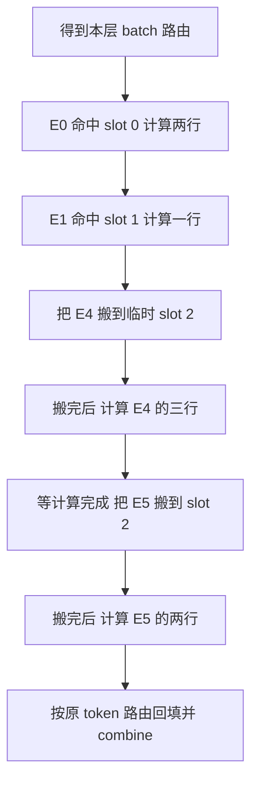
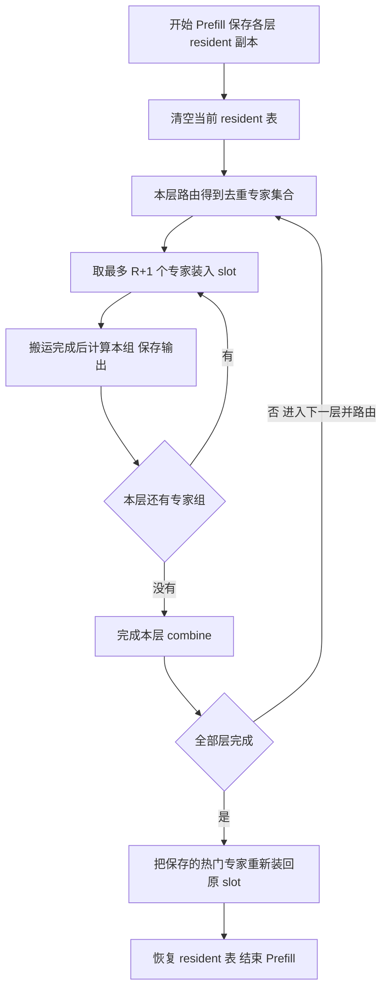

# SGLang NPU MoE 专家缓存基础功能设计

版本：0.2。日期：2026 年 10 月 19 日。

这版只实现一条完整的功能链：CPU 保存专家权重，HBM 保存部分热门专家；Decode 按需加载，Prefill 分组计算，定期按热度更新缓存。

基础版采用**同步搬运、单个 forward 顺序执行、固定 slot 分配**。复制和计算暂不重叠，缓存调整在完整 forward 结束后完成。由此不需要后台预装队列、租约、generation、映射版本和事务发布。

代码基线为 SGLang 提交 1a7af3290dda0de77a042037b8570d7ff89f3f85。下面是拟实现设计；[配套 Python 接口](npu_moe_expert_cache_interfaces.py) 仅用于定义接口，尚未接入运行代码。

## 1 功能范围

保留以下功能：

1. 每个 EP rank 保存自己负责的专家 CPU 权重，并维护各层 HBM 缓存。
2. 根据离线频次初始化热门专家。
3. Decode/Verify 对整个 batch 按专家查缓存；缺失时加载后计算。
4. 每 4 个 Decode/Verify forward 按用户提出的 LFU 规则更新缓存。
5. Prefill 借用缓存空间分组计算，结束后恢复原缓存。

第一版接入普通 EP dispatch → Ascend MoE → combine 路径，固定一种已跑通的量化格式和 dispatcher，例如 ModelSlim W8A8 与 DeepEP normal。缓存路径先用 eager 模式，专家放置固定，各 forward 顺序执行。

共享专家、draft 模型和配置排除的层沿用原计算路径。截图中的前三层 hash MoE 通过目标模型的排除层配置表达。

## 2 缓存结构

每层分配 R 个驻留 slot 和 1 个临时 slot：

```text
当前 EP rank
│
├─ 层 3
│   CPU：本 rank 拥有的完整专家权重
│   HBM：slot 0 ... slot R-1  热门专家
│        slot R              临时加载
│
└─ 层 4
    CPU：本 rank 拥有的完整专家权重
    HBM：slot 0 ... slot R-1  热门专家
         slot R              临时加载
```

每层只维护五项数据：

| 字段 | 内容 |
|---|---|
| cpu_weights | expert_id → CPU 专家权重 |
| slots | R+1 份预分配的 HBM 权重空间 |
| slot_experts | 每个 slot 当前装了哪个专家 |
| resident | 驻留 expert_id → slot_id |
| usage | 每个专家的在线热度 |

例如 R=2：

```text
slots          = [E0 权重, E1 权重, 临时空间]
slot_experts   = [0, 1, None]
resident       = {0: 0, 1: 1}
usage          = {0: 0, 1: 0, 2: 0, 3: 0, 4: 0, 5: 0}
```

不同层的 E0 权重不同，因此每层有自己的表。计算完层 3 后不清空它的热门专家，下一次 forward 仍可命中。

一个专家的权重包括 w13、w2 及该量化格式需要的 scale、offset、bias 等组件。slot 保存这一整套数据，不能只搬矩阵而遗漏量化参数。

## 3 总体流程



## 4 初始化

初始化由模型加载路径完成：

1. 加载本 rank 专家权重到 CPU pinned DRAM，准备选定算子需要的权重和量化参数。
2. 给每个参与卸载的层分配 R+1 个 HBM slot。
3. 在每层内按离线路由频次排序，把前 R 个专家装入驻留 slot。
4. 设置 resident 和 slot_experts，在线 usage 从 0 开始。

离线频次用于选初始专家，不直接加入在线 usage。这样不会把大量离线计数带入在线替换。

权重加载和量化后处理需要按专家或有界分片执行，避免初始化时仍要求全层专家都能放进 HBM。HBM 预算为各层 slot 池加上非卸载权重、KV 和计算空间。

针对第一版选定的格式，只做一种具体的装载实现。NPU 格式转换若必须在设备进行，就把它放进该装载步骤，并在返回前完成；不另外设计通用的格式版本框架。

## 5 Decode 和 Verify

### 5.1 整个 batch 按专家处理

假设 batch 有四个 token：

| Token | 选择的专家 |
|---|---|
| T0 | E0、E4 |
| T1 | E1、E4 |
| T2 | E4、E5 |
| T3 | E0、E5 |

按专家聚合后：

```text
E0 → T0、T3       count=2
E1 → T1          count=1
E4 → T0、T1、T2  count=3
E5 → T2、T3      count=2
```

假设 E0、E1 已驻留：



E4 被三个 token 使用，但只加载一次。slot 2 后来换成 E5 时，E4 的计算输出已经保存在输出缓冲中，不会随权重覆盖而丢失。

### 5.2 计算接口处理

在 Ascend 缓存 runner 内完成三个步骤：

1. 根据 dispatch 结果，把有效 token-expert 行按专家分组，同时保存原来的输出位置。
2. 对每个专家调用 get_slot，使用对应 slot 的权重计算该专家全部 token。
3. 把各组输出回填到原布局，交给现有 combine。

第一版可以逐专家构造单专家 AscendQuantInfo，复用现有算子。slot_id 只决定权重来自哪里，token 输入 Tensor 仍要传入。

每层 usage 更新一次：E0 += 2、E1 += 1、E4 += 3、E5 += 2。只统计有效路由行，不统计 padding。Verify 中已经执行但最终未被接受的候选 token 仍保留计数。

### 5.3 每 4 轮更新驻留专家

一次完整 batch 的模型 forward 算一轮，与其中有多少 token 无关。Decode 和 target Verify 合并计数，Prefill、draft 和 warmup 不计数。

第 4 轮结束后，先等待当前计算完成，再执行：

1. 每层将非驻留专家按热度从高到低排序，将驻留专家从低到高排序，一一配对。
2. 候选满足 usage_new ≥ 2 且 usage_new ≥ 1.5 × usage_old 才保留。
3. 汇总本 rank 所有层的配对，按热度差降序选最多 96 个。同分按层号、专家号排序。
4. 把新专家直接搬入被替换者的驻留 slot，搬完后更新两个表。
5. 所有 usage 乘 0.7。

例如 E4 热度为 3、E1 热度为 1，可以将 slot 1 从 E1 换成 E4：

```text
替换前：resident = {E0: slot 0, E1: slot 1}
复制 E4 → slot 1，等待完成
替换后：resident = {E0: slot 0, E4: slot 1}
```

由于替换期间没有 forward 使用缓存，不需要先在临时 slot 预装，再进行复杂的发布操作。即时 miss 仍走临时 slot，不能等到第 4 轮才执行。

## 6 Prefill

Prefill 借用本层全部 R+1 个 slot，按 batch 实际需要的专家分组加载。



R=2 时每组最多三个专家。如果当前层需要 E0 到 E5，可以加载两组；每组权重搬完再计算，计算结束再覆盖。组内先用逐专家调用实现即可，不要求新增融合算子。

这里只加载本 batch 需要的专家，不要求每次 Prefill 都把所有专家读取一遍。Prefill 不更新 Decode usage。

基础版结束时按保存的表重新装回热门专家，不额外判断哪些权重可以免复制。恢复完成后才能开始下一次 Decode。普通 chunked prefill 按每个完整 chunk forward 执行上述流程。

## 7 最少的同步规则

基础版由一个控制线程顺序提交 forward，权重加载使用同步完成的接口。只保留两条必要规则：

- 覆盖一个 slot 前，等待之前的计算完成。
- 使用新权重计算前，等待本次权重复制及必要格式转换完成。

最简单的内部拷贝方法可以写成：

```python
def _copy_to_slot(layer_id, expert_id, slot_id):
    torch.npu.synchronize()
    copy_all_components_to_slot(layer_id, expert_id, slot_id)
    torch.npu.synchronize()
    layers[layer_id].slot_experts[slot_id] = expert_id
```

这里 copy_all_components_to_slot 是拟实现的具体拷贝函数，不是已有 API。它把 w13、w2 和量化组件复制到已分配的 slot；synchronize 的代价由基础版接受。

周期替换和 Prefill 恢复都在 end_forward 内同步完成。因此不维护 LOADING/READY 状态机，不返回 CopyTicket，也不暴露设备事件接口。

## 8 接口定义

### 8.1 数据结构

```python
@dataclass
class ExpertWeights:
    w13: Tensor
    w2: Tensor
    extras: dict[str, Tensor]  # scale、offset、bias 等

@dataclass
class LayerCache:
    cpu_weights: dict[int, ExpertWeights]
    slots: list[ExpertWeights]
    slot_experts: list[int | None]
    resident: dict[int, int]
    usage: dict[int, float]
```

配置仅保留驻留 slot 数，以及 4、2、1.5、96、0.7 五个策略参数。临时 slot 固定为每层一个。

### 8.2 缓存管理器

| 接口 | 输入 | 做什么 | 返回 |
|---|---|---|---|
| initialize | 本 rank 各层 CPU 权重、离线频次、配置 | 分配 slot，装入各层前 R 个热门专家 | 无 |
| begin_forward | prefill/decode/verify | 记录模式；Prefill 保存并清空驻留表 | 无 |
| get_slot | layer_id、expert_id | Decode/Verify 命中返回驻留 slot，否则同步加载到临时 slot | slot_id |
| load_prefill_group | layer_id、不超过 R+1 个专家 ID | 同步装入 slot 0 到 n-1 | slot_id 列表 |
| add_usage | layer_id、专家到有效 token 数的字典 | Decode/Verify 每层累加一次热度 | 无 |
| end_forward | 无 | 等待计算；Prefill 恢复缓存，Decode/Verify 推进周期并按需替换 | 无 |

get_slot 返回后，调用方必须先提交该专家的计算，再调用下一次可能覆盖临时 slot 的加载。不能先为整个 miss 列表调用 get_slot，最后才统一计算，否则前面返回的临时 slot 已经换了内容。

load_prefill_group 也是加载一组、计算一组，然后再加载下一组。

### 8.3 缓存 runner

```python
class CachedMoERunner:
    def run(self, layer_id, dispatch_output, cache):
        # 返回与原路径相同的 CombineInput
        ...
```

runner 内部完成 token 分组、slot 权重选择、专家计算和结果回填，不再拆成独立的路由适配、租约和计划框架。已有 EP 原始专家编号、路由权重与通信句柄保持原语义，不能替换成 slot_id。

Decode/Verify 核心逻辑：

```python
def run_decode_layer(layer_id, dispatch_output):
    groups, output_meta = group_tokens_by_expert(dispatch_output)
    cache.add_usage(layer_id, {g.expert_id: g.valid_count for g in groups})
    outputs = []
    for group in groups:
        slot_id = cache.get_slot(layer_id, group.expert_id)
        weights = cache.layers[layer_id].slots[slot_id]
        y = run_expert(group.x, group.x_scale, weights)
        outputs.append((group.output_rows, y))
    return restore_combine_input(outputs, output_meta)
```

示例中的分组、计算和恢复函数由缓存 runner 实现。专家输出保留到回填结束，量化 token scale 随 token 一起分组；路由权重沿原路径只应用一次。

## 9 代码修改位置

新增两个主要文件即可：

- hardware_backend/npu/moe/expert_cache.py：数据结构、slot、同步搬运、Prefill 恢复和 LFU 更新。
- hardware_backend/npu/moe/cached_runner.py：batch 按专家分组、使用 slot 计算、输出回填。

以上是拟新增的仓库内模块名。已有代码的接入点如下：

| 位置 | 基础版修改 |
|---|---|
| [model_loader/loader.py](https://github.com/sgl-project/sglang/blob/1a7af3290dda0de77a042037b8570d7ff89f3f85/python/sglang/srt/model_loader/loader.py#L1088) | 专家权重保存在 CPU，后处理避免全层专家同时上卡 |
| [modelslim/modelslim.py](https://github.com/sgl-project/sglang/blob/1a7af3290dda0de77a042037b8570d7ff89f3f85/python/sglang/srt/layers/quantization/modelslim/modelslim.py#L527) 及所选 scheme | 调整权重分配；apply 在开启缓存时调用 CachedMoERunner |
| [model_executor/model_runner.py](https://github.com/sgl-project/sglang/blob/1a7af3290dda0de77a042037b8570d7ff89f3f85/python/sglang/srt/model_executor/model_runner.py#L1755) | 模型执行前后调用 begin_forward/end_forward |
| [moe_runner/ascend.py](https://github.com/sgl-project/sglang/blob/1a7af3290dda0de77a042037b8570d7ff89f3f85/python/sglang/srt/layers/moe/moe_runner/ascend.py#L205) | 复用现有专家计算和 dispatch 元数据处理逻辑 |
| [npu/moe/matmul.py](https://github.com/sgl-project/sglang/blob/1a7af3290dda0de77a042037b8570d7ff89f3f85/python/sglang/srt/hardware_backend/npu/moe/matmul.py#L24) | 验证单专家 slot 视图可用于现有 GMM；必要时做小范围适配 |
| [arg_groups/fields/exec_.py](https://github.com/sgl-project/sglang/blob/1a7af3290dda0de77a042037b8570d7ff89f3f85/python/sglang/srt/arg_groups/fields/exec_.py#L950) | 增加开关、驻留容量、离线频次文件与策略参数 |

现有 [FusedMoE.forward_impl](https://github.com/sgl-project/sglang/blob/1a7af3290dda0de77a042037b8570d7ff89f3f85/python/sglang/srt/layers/moe/fused_moe_triton/layer.py#L1550) 的 dispatch → 本地 MoE → combine 顺序保留。每个 rank 分组次数可以不同，本地组之间不新增 EP collective。

模式判断使用明确的 Decode、target Verify 和普通 Prefill 分支。当前 [ForwardMode.is_extend](https://github.com/sgl-project/sglang/blob/1a7af3290dda0de77a042037b8570d7ff89f3f85/python/sglang/srt/model_executor/forward_batch_info.py#L224) 包含 Verify，不能直接用它决定是否借用缓存。

## 10 开发与验收

按三步完成：

1. 先打通 CPU 权重、固定 slot 和 Decode batch 的命中/缺失计算。
2. 增加 Prefill 借用与恢复，确认阶段切换输出正确。
3. 增加离线热启动、在线 usage 和每 4 轮 LFU 替换。

基础验收只覆盖核心行为：

| 用例 | 预期 |
|---|---|
| batch 全命中 | 不发生专家权重 H2D |
| 三个 token 选择同一缺失专家 | 复制一次，计算三行，usage 加三 |
| 缺失专家多于临时 slot | 顺序加载计算，输出完整 |
| 第四个 Decode/Verify forward 结束 | 按阈值替换、更新映射、全部 usage 乘 0.7 |
| Prefill 之后再 Decode | 原驻留专家已经恢复，能正确命中 |
| 缓存路径对照原路径 | 单层和端到端输出符合所选量化格式的精度要求 |

只记录命中专家数、H2D 字节和每轮耗时，足够判断功能与初步收益。基础版不增加异常恢复、自动重试和复杂兼容框架，运行错误沿用现有 worker 的报错处理。

这版的交付标准是：选定模型和 EP 路径能用有限 HBM 完成 Prefill、Decode/Verify，并按规则复用与替换专家。同步等待带来的性能代价留给后续异步优化处理。
